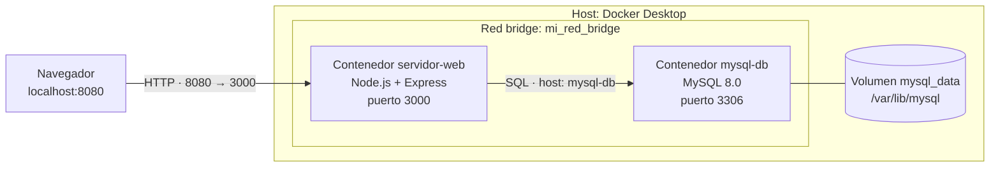
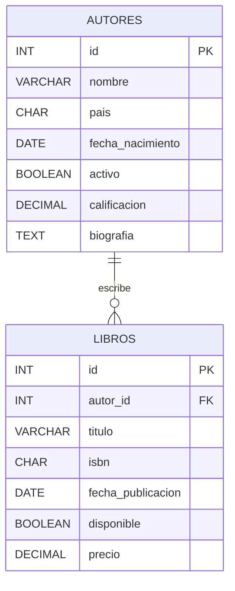

# Biblioteca con Docker: MySQL + Node.js

Proyecto académico que demuestra el uso de **Docker** para empaquetar y ejecutar una aplicación web de dos capas: una base de datos relacional (MySQL) y un servidor web (Node.js + Express). Cada capa corre en su propio contenedor, construido a partir de su propia imagen, y ambos se comunican a través de una red `bridge` personalizada.

## Descripción

El proyecto cubre los siguientes requisitos:

1. Instalación de **Docker Desktop**, uso de la consola y creación/eliminación de imágenes y contenedores.
2. Imagen de una base de datos relacional (**MySQL 8**) con **dos tablas relacionadas** (`autores` y `libros`), cada una con **7 columnas** de distintos tipos de datos (entero, fecha, booleano, carácter, decimal, texto).
3. Imagen de un servidor web (**Node.js**).
4. Aplicación web desplegada en un contenedor y accesible desde el navegador.
5. Ingreso de **15 registros** desde un formulario, almacenados en MySQL, y visualización de los datos guardados en un **enlace distinto** (`/libros`).

Todo corre dentro de contenedores. La página muestra al pie el **ID del contenedor** (hostname) que la sirve, como evidencia de que se usa Docker.

Todas las herramientas usadas son gratuitas: Docker Desktop (uso personal/educativo), imágenes oficiales `mysql` y `node` y Docker Hub (cuenta gratuita).

## Funcionamiento

### Arquitectura



- **`mysql-db`**: construido desde `db/Dockerfile`. Al iniciar por primera vez, MySQL ejecuta `init.sql` (carpeta `docker-entrypoint-initdb.d`), que crea las tablas e inserta 5 autores.
- **`servidor-web`**: construido desde `web/Dockerfile`. Se conecta a MySQL usando el nombre del contenedor (`mysql-db`) como host, gracias al DNS interno de la red `mi_red_bridge`.
- **`mysql_data`**: volumen de Docker que conserva los datos aunque el contenedor se reinicie o se elimine.

### Modelo entidad-relación

Un autor puede tener muchos libros (1:N). La llave foránea `libros.autor_id` impide registrar un libro con un autor inexistente o borrar un autor que tenga libros.



### Rutas de la aplicación web

| Ruta | Método | Función |
|------|--------|---------|
| `/` | GET | Formulario para registrar un libro (el autor se elige de una lista cargada desde la BD). |
| `/guardar` | POST | Inserta el libro en la tabla `libros` y redirige a `/libros`. |
| `/libros` | GET | Muestra todos los libros guardados (JOIN con `autores`) y el total de registros. |

### Estructura del proyecto

```
proyecto-docker/
├── db/
│   ├── Dockerfile        # FROM mysql:8.0 + init.sql
│   └── init.sql          # tablas autores y libros + 5 autores
├── web/
│   ├── Dockerfile        # FROM node:20-alpine
│   ├── package.json      # express, mysql2
│   ├── server.js         # aplicación web
│   └── public/logo.png   # imagen opcional mostrada en la página
├── docker_cheatsheet.sh
├── borraTodo.sh
└── README.md
```

### Requisitos

- Docker Desktop instalado y en ejecución (en Windows con WSL 2).
- Puerto **8080** libre en el equipo.
- Cuenta gratuita en Docker Hub (solo para publicar las imágenes).

### Inicio rápido

```bash
docker network create mi_red_bridge
docker volume create mysql_data
docker build -t mscamarodriguezg/mysql-biblioteca:1.0 ./db
docker run -d --network mi_red_bridge --name mysql-db -e MYSQL_ROOT_PASSWORD=Clave123 -v mysql_data:/var/lib/mysql mscamarodriguezg/mysql-biblioteca:1.0
docker build -t mscamarodriguezg/sitioweb:latest ./web
docker run -d -p 8080:3000 --network mi_red_bridge --name servidor-web -e DB_HOST=mysql-db -e DB_PASSWORD=Clave123 mscamarodriguezg/sitioweb:latest
```

Luego abre <http://localhost:8080>. MySQL tarda entre 20 y 30 segundos en quedar listo la primera vez; si el formulario muestra un error de conexión, espera y recarga.

> **Nota:** `Clave123` es una contraseña de demostración. Cámbiala para cualquier uso fuera de la práctica.

---

## Listado de comandos por escenas

Los comandos van en una sola línea para que funcionen igual en PowerShell, CMD y Bash. En total son **57 comandos Docker**.

### Escena 1: Instalación de Docker Desktop y primeros comandos

Descargar Docker Desktop desde docker.com, ejecutar el instalador, reiniciar si lo solicita, abrir Docker Desktop, esperar el estado "Engine running" y abrir la consola.

```bash
docker --version                      # 1
docker version                        # 2
docker info                           # 3
docker run hello-world                # 4  descarga la imagen y crea un contenedor
docker ps                             # 5  contenedores en ejecución (vacío)
docker ps -a                          # 6  se ve hello-world en estado "Exited"
docker images                         # 7  se ve la imagen hello-world
```

### Escena 2: Crear y eliminar una imagen y un contenedor

```bash
docker pull alpine                                  # 8  descargar una imagen
docker run -it --name prueba alpine /bin/sh         # 9  contenedor interactivo (escribe `exit` para salir)
docker ps -a                                        # 10 localizar el ID/nombre
docker rm prueba                                    # 11 eliminar el contenedor detenido
docker rm $(docker ps -q -a)                        # 12 eliminar todos los contenedores (hello-world)
docker rmi hello-world                              # 13 eliminar la imagen por nombre
docker images                                       # 14 verificar que solo queda alpine
```

### Escena 3: Red y volumen

```bash
docker network create mi_red_bridge                 # 15 red bridge personalizada
docker network ls                                   # 16
docker volume create mysql_data                     # 17 volumen para que los datos persistan
```

### Escena 4: Imagen de la base de datos (MySQL) y contenedor

```bash
docker build -t mscamarodriguezg/mysql-biblioteca:1.0 ./db                                  # 18 construir imagen de BD
docker run -d --network mi_red_bridge --name mysql-db -e MYSQL_ROOT_PASSWORD=Clave123 -v mysql_data:/var/lib/mysql mscamarodriguezg/mysql-biblioteca:1.0   # 19
docker logs mysql-db                                # 20 esperar "ready for connections"
docker exec -it mysql-db mysql -uroot -pClave123 biblioteca    # 21 entrar al cliente MySQL
```

Dentro de MySQL (escribe `exit` al terminar):

```sql
SHOW TABLES;
DESCRIBE autores;
DESCRIBE libros;
SELECT id, nombre, pais FROM autores;
-- Demostrar la dependencia entre tablas (falla porque no existe el autor 99):
INSERT INTO libros (autor_id,titulo,isbn,fecha_publicacion,precio) VALUES (99,'Prueba','1234567890123','2024-01-01',10);
```

### Escena 5: Imagen del servidor web (Node.js) y despliegue

```bash
docker build -t mscamarodriguezg/sitioweb:latest ./web         # 22 construir imagen del servidor
docker images                                                  # 23 se ven mysql-biblioteca y sitioweb
docker run -d -p 8080:3000 --network mi_red_bridge --name servidor-web -e DB_HOST=mysql-db -e DB_PASSWORD=Clave123 mscamarodriguezg/sitioweb:latest   # 24
docker ps                                                      # 25 ambos contenedores corriendo
docker logs servidor-web                                       # 26 "Servidor listo en el puerto 3000"
docker port servidor-web                                       # 27 puerto 3000 → 8080 del host
```

Abrir `http://localhost:8080` y mostrar que la página (con la imagen/logo) la sirve el contenedor, con el ID del contenedor en el pie de página.

Variante con puertos automáticos:

```bash
docker run -d -P --network mi_red_bridge --name servidor-web-auto -e DB_HOST=mysql-db -e DB_PASSWORD=Clave123 mscamarodriguezg/sitioweb:latest   # 28
docker port servidor-web-auto                                  # 29 muestra el puerto aleatorio asignado
```

Prueba entre contenedores por nombre (DNS de la red):

```bash
docker run -it --network mi_red_bridge --name cliente alpine /bin/sh      # 30
wget -qO- http://servidor-web:3000/libros | head -n 15                      # dentro del contenedor, luego `exit`
```

### Escena 6: Ingreso de 15 datos y verificación

1. En `http://localhost:8080` registrar **15 libros** con el formulario (ISBN de 13 dígitos, por ejemplo `9780000000001` al `9780000000015`). Cada guardado redirige a `/libros`.
2. Abrir `http://localhost:8080/libros`: deben aparecer los 15 registros y el título debe indicar "(15)".
3. Verificar en el contenedor de la BD que los datos están guardados:

```bash
docker exec mysql-db mysql -uroot -pClave123 -e "SELECT COUNT(*) AS total FROM libros;" biblioteca      # 31
docker exec -it mysql-db mysql -uroot -pClave123 -e "SELECT l.id,l.titulo,a.nombre FROM libros l JOIN autores a ON a.id=l.autor_id;" biblioteca   # 32
docker exec -it mysql-db /bin/bash                                  # 33 shell dentro del contenedor (`exit` para salir)
```

### Escena 7: Evidenciar el uso del contenedor

```bash
docker ps                                           # 34
docker stats --no-stream                            # 35 CPU y memoria de cada contenedor
docker top servidor-web                             # 36 procesos dentro del contenedor (node server.js)
docker inspect servidor-web --format "{{.NetworkSettings.Networks.mi_red_bridge.IPAddress}}"   # 37 IP en la red
docker network inspect mi_red_bridge                # 38 contenedores conectados
docker history mscamarodriguezg/sitioweb:latest     # 39 capas de la imagen
docker cp mysql-db:/docker-entrypoint-initdb.d/init.sql ./init_copia.sql      # 40 copiar archivo desde el contenedor
```

Persistencia de datos:

```bash
docker restart mysql-db                             # 41
docker stop servidor-web                            # 42
docker start servidor-web                           # 43 recargar /libros: los 15 datos siguen ahí
```

### Escena 8: Publicar las imágenes en Docker Hub

```bash
docker login                                                                          # 44
docker tag mscamarodriguezg/sitioweb:latest mscamarodriguezg/sitioweb:1.0             # 45
docker push mscamarodriguezg/sitioweb:latest                                          # 46
docker push mscamarodriguezg/mysql-biblioteca:1.0                                     # 47
```

Docker Hub gratuito permite repositorios públicos ilimitados y uno privado.

### Escena 9: Limpieza (adaptada de `borraTodo.sh`)

```bash
docker system df                                    # 48 espacio usado
docker stop $(docker ps -q -a)                      # 49 detener todos
docker rm $(docker ps -q -a)                        # 50 eliminar todos los contenedores
docker rmi $(docker images -q -a)                   # 51 eliminar todas las imágenes
docker image prune -a -f                            # 52 imágenes sin uso
docker container prune -f                           # 53 contenedores detenidos
docker volume prune -a -f                           # 54 volúmenes sin uso (borra mysql_data)
docker system prune -a -f                           # 55 todo lo no usado
docker builder prune -a -f                          # 56 caché de compilación
docker ps -a ; docker images ; docker volume ls     # 57 todo vacío
```

Para el cierre se puede ejecutar el script completo con `bash borraTodo.sh` (en Windows, desde Git Bash o WSL).

> **Advertencia:** `borraTodo.sh` y los comandos de la Escena 9 eliminan **todos** los contenedores, imágenes y volúmenes del equipo, no solo los de este proyecto. Úsalos únicamente al final y si no tienes otros proyectos Docker que conservar. Si aparece el error "requires at least 1 argument", significa que ya no hay contenedores o imágenes que borrar y es inofensivo.

## Solución de problemas

| Problema | Posible causa y solución |
|----------|--------------------------|
| El formulario muestra un error de conexión | MySQL aún está iniciando. Revisa `docker logs mysql-db` y espera "ready for connections". |
| `port is already allocated` | El puerto 8080 está ocupado. Usa otro, por ejemplo `-p 8081:3000`. |
| `init.sql` no se ejecuta | Solo corre cuando el volumen `mysql_data` está vacío. Borra el volumen (`docker volume rm mysql_data`) y recrea el contenedor. |
| `volume prune -a` da error | Es una bandera de versiones recientes de Docker. Quita el `-a`. |
| El nombre del contenedor ya existe | Elimínalo con `docker rm <nombre>` antes de volver a crearlo. |